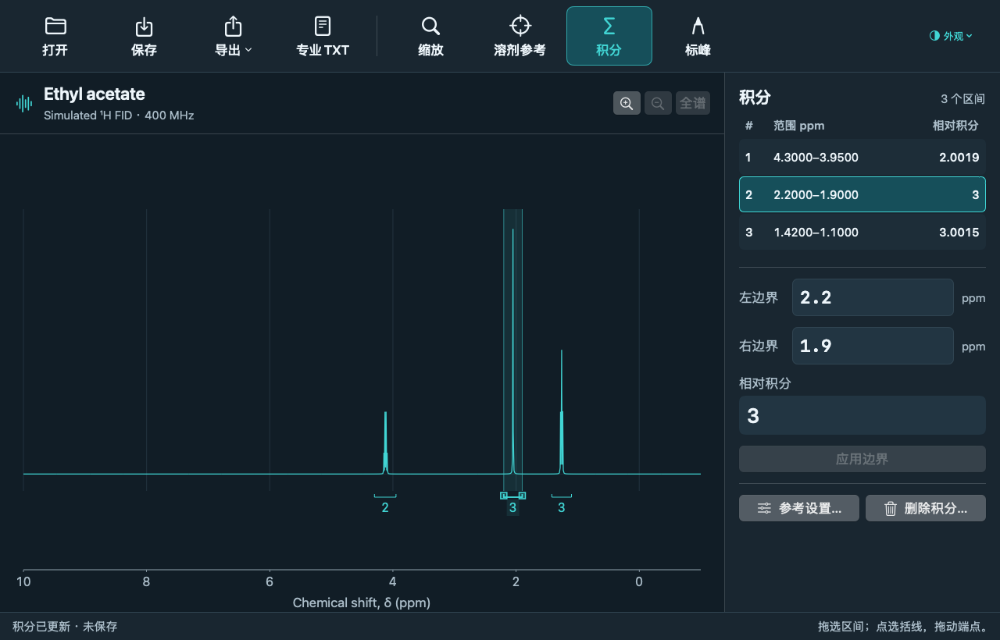
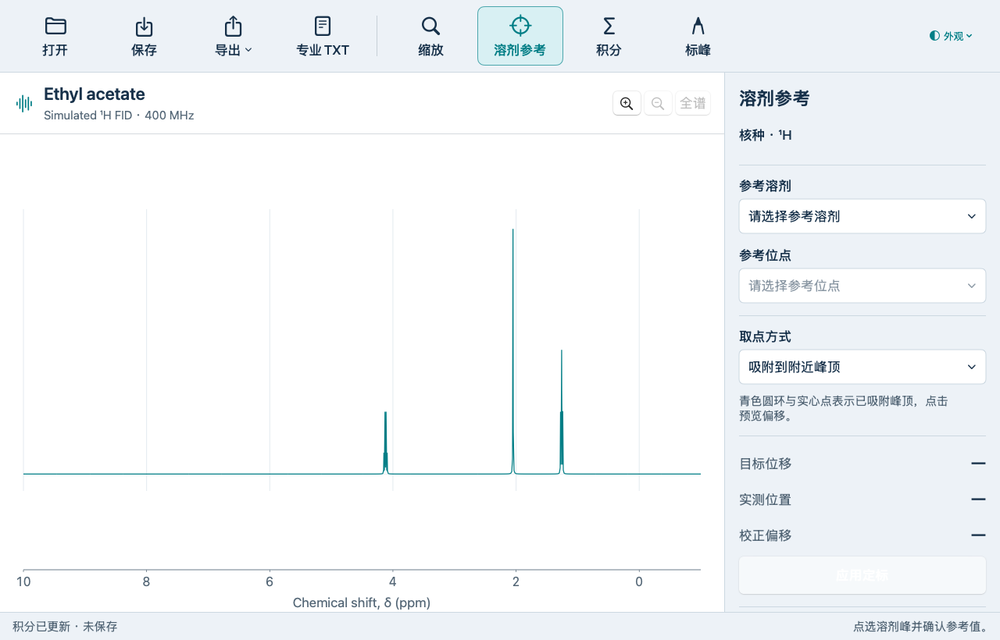

# NMR Studio

面向 Apple 芯片 Mac 的轻量一维核磁谱工作台。可读取 Bruker 原始 FID 和处理谱，完成化学位移定标、积分、标峰和专业谱图文本导出。谱图在本机处理。

各版功能、修复和界面设计迭代统一记录在[修改记录](CHANGELOG.md)，其中明确区分已实现版本与待确认设计。

## 下载与安装

1. 在[发行版](https://github.com/StephenQiu628/NMR-Studio/releases/latest)中下载 `NMR-Studio-0.6.0-macOS-arm64.zip`。
2. 解压后，将 `NMR Studio.app` 拖入「应用程序」，再打开。
3. 启动时会显示模拟氢谱，可以直接试用积分和标峰。

需要 **Apple 芯片 Mac，macOS 13 或更新版本**。下载包使用本地签名，尚未经过 Apple 公证。发行版附有 SHA-256 校验值，可用 `shasum -a 256 NMR-Studio-0.6.0-macOS-arm64.zip` 核对。

## 使用界面





上图为应用实际渲染的模拟氢谱。顶部采用图标在上、文字在下的工具栏；右上角「外观」可切换深色、浅色或跟随系统，并记住选择。常用文字为 17 pt，坐标刻度为 16 pt。

四个谱图工具是「缩放」「溶剂参考」「积分」「标峰」，可按 ⌘1 至 ⌘4 切换。「积分」右侧显示结果表、精确边界与参考设置；「溶剂参考」右侧显示溶剂、位点和定标预览。积分结果只在积分工具中显示，切换工具会保留已有测量。导出的 PDF 和 PNG 保持白底。

## 基本操作

可以用内置模拟氢谱中约 **2 ppm** 的孤立峰练习缩放、积分和标峰。

| 步骤 | 怎么做 |
| --- | --- |
| 1. 打开数据 | 点「打开」或按 ⌘O。处理 Bruker 原始数据时，选取 `fid` 并保留同目录的 `acqus`。软件会自动展宽、零填充、傅里叶变换、调相，再评估基线。打开实验目录时优先读取已有的 `1r`。也可打开双列 CSV、TSV、TXT 或 `.nmrstudio` 工程。 |
| 2. 缩放 | 选「缩放」，在谱图上横向拖选想看的范围。点「全谱」或按 ⌘0 恢复。 |
| 3. 参考定标（按需） | 选「溶剂参考」，选择溶剂和参考位点，再点击谱图上的对应峰。支持峰顶吸附、TFA-d 和自定义目标位移。确认实测值、目标值和偏移后应用。 |
| 4. 积分 | 选「积分」，沿横轴拖过完整峰组。点选括线或右侧结果行后，拖动括线左端或右端调整边界，松开提交，Esc 取消。也可在右侧输入精确边界后点「应用边界」，通过「参考设置」指定归一参考值。 |
| 5. 标峰 | 选「标峰」，用矩形框住要记录的谱线。框同时限定 ppm 和强度。松手后矩形消失，峰位显示在谱图上方。可以连续标峰，再统一审阅。 |
| 6. 导出或保存 | 点「专业 TXT」生成文本草稿。「导出」菜单提供全谱或当前范围 CSV、矢量 PDF、1200 或 3600 像素 PNG。按 ⌘S 保存 `.nmrstudio` 工程，下次可继续处理和测量。 |

从 `fid` 打开时，自动调相会比较不同谱区的峰翼和吸收峰面积，估计零阶相位与一阶相位。随后根据峰间背景评估基线偏移和弯曲程度。底部状态栏会显示采用的校正方式，也会在背景偏移已低于阈值时说明原因。打开 `.nmrstudio` 时会还原保存的处理参数、积分和标峰。

### 导出专业 TXT

1. 积分、标峰后，点工具栏的「专业 TXT」。软件会按当前标峰和积分生成草稿。
2. 核对观测频率。通过「选择溶剂」指定样品溶剂，也可以直接输入。溶剂选择用于文本谱头。化学位移定标在主界面的「溶剂参考」中操作。
3. 看右侧正文预览，按需展开「草稿编辑」，调整纳入的峰和字段，再点「确认并导出」。一次确认整稿即可。只有一份 ¹H 或 ¹³C 也能导出。未确定的裂分、J 值和氢数可以省略。

「保存草稿到工程」保留本次报表编辑，再按 ⌘S 写入工程文件。

当前支持一维复数采集模式 QSIM 和 DQD，以及显式 `GRPDLY` 和部分旧式数字滤波参数。其他采集模式可尝试读取仪器导出的全幅 `1r` 或双列谱图。自动处理结果可结合谱图和底部状态栏核对。

## 从源码构建

在装有 Xcode 命令行工具的 Apple 芯片 Mac 上运行：

```bash
bash build.sh
bash test.sh
bash test-ui.sh
```

构建产物位于仓库根目录的 `NMR Studio.app`。核心测试使用合成谱，覆盖文件读写、频域处理、真实 AppKit 积分拖动事件、工程保存和导出。`test-ui.sh` 在已登录的 macOS 图形会话中渲染深浅主题及四种工具，检查模式显示隔离、原始数据不变和最小窗口；截图保存至 `.build/ui-checks/`。

| 路径 | 内容 |
| --- | --- |
| `Sources/` | SwiftUI 界面、Bruker 读取、谱图处理、测量和导出 |
| `Tests/` | 自动化检查 |
| `Resources/` | macOS 应用图标 |
| `Tools/` | 图标生成工具 |

## 第三方致谢

ACME 调相代码包含对 [OpenReadout](https://github.com/openreadout/openreadout) 相关实现的适配。对应 MIT 许可证见 [第三方许可证](OpenReadout-LICENSE-MIT.txt)。
